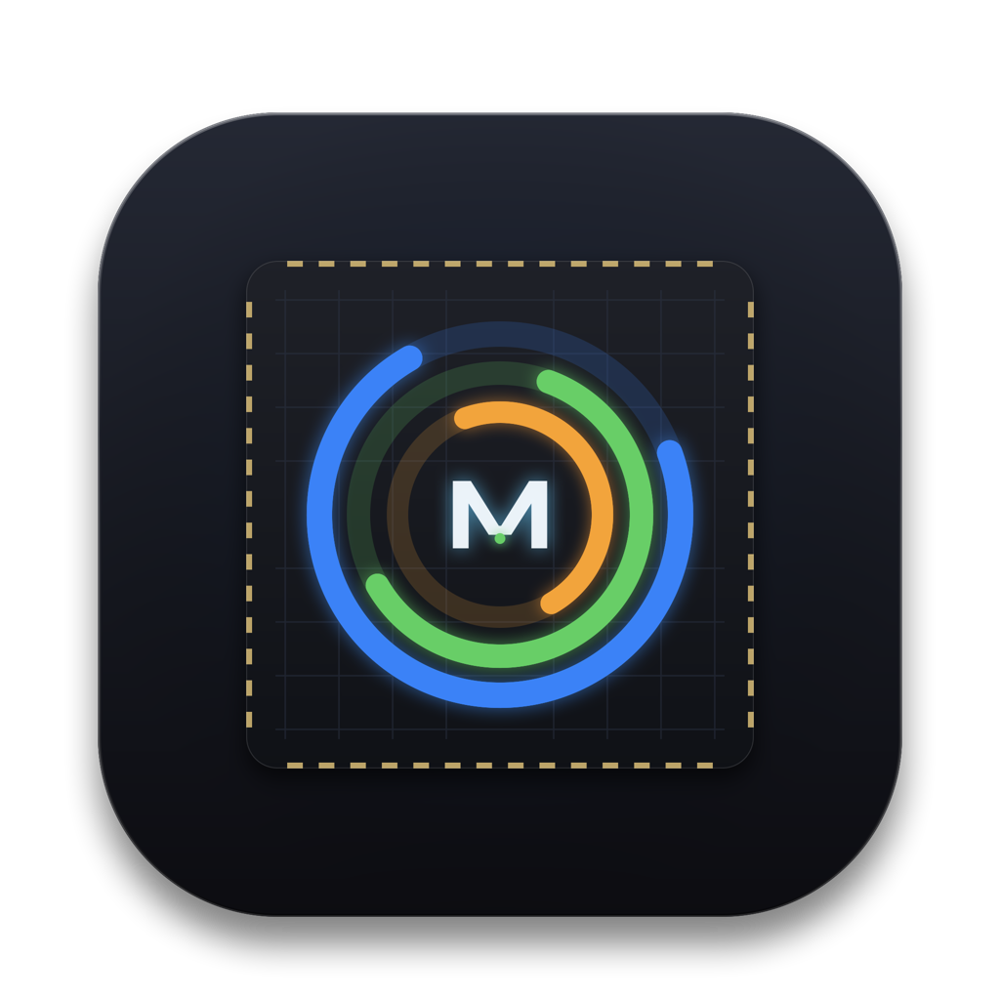

<p align="center">
  
</p>

<h1 align="center">MacStatus</h1>

<p align="center">
  <em>A native, ultra-lightweight, and clutter-free hardware status monitor for the macOS Menu Bar — meticulously crafted for Apple Silicon (M1/M2/M3/M4).</em>
</p>

[](https://apple.com)
[-orange?style=flat-square)](https://apple.com)
[](https://swift.org)
[](LICENSE)

---

## 🌟 Overview

**MacStatus** is a native macOS menu bar utility designed to replace bulky, power-hungry status monitor apps. Built purely with **Swift 6, SwiftUI, and AppKit**, it provides vital system health metrics at a glance using compact circular activity rings, with zero clutter and minimal resource overhead.

```text
┌────────────────────────────────────────────────────────┐
│  (◎ 14%  ◎ 58%  ◎ 68%   ⇅ 1.2M   42.0°C)               │  <- Menu Bar
└────────────────────────────────────────────────────────┘
```

When clicked, it expands into an elegant Apple-style popover displaying detailed real-time telemetry, core breakdown, top consuming processes, and thermal conditions.

---

## ✨ Features

### 1. Minimalist Menu Bar Glance
* **Activity Rings:** Color-coded circular gauges for **CPU** (Blue), **RAM** (Green), and **SSD** (Orange).
* **Live Network Badge:** Instant total throughput indicator (e.g. `⇅ 1.2M`).
* **SoC Temperature:** Real-time Apple Silicon chip temperature (e.g. `42.0°C`).
* **Zero Jitter:** Fixed-width container layout prevents status bar bouncing and notch clipping on modern MacBooks.

### 2. Deep Telemetry Popover
* **⚡ CPU Processor:**
  * Real-time total usage percentage.
  * Efficiency Cores (E-Cores) vs Performance Cores (P-Cores) workload distribution.
  * Live Top 3 CPU-consuming processes.
* **🧠 Unified Memory (RAM):**
  * Used vs Total capacity breakdown (e.g., `18.6 GB / 32.0 GB`).
  * App Memory & Wired Memory tracking.
  * Live Top 3 Memory-consuming processes.
* **💾 Storage (Macintosh HD):**
  * Free storage space and percentage used.
* **🌐 Network:**
  * Separate real-time Download (▼) and Upload (▲) transfer rates.
  * Active Local IP address.
* **🌡 Apple Silicon SoC Thermal:**
  * Hardware sensor readout in Celsius via `IOHIDEventSystem`.
  * Thermal pressure states (`Nominal`, `Fair`, `Serious`).
* **⚡ Quick Actions:**
  * One-click shortcut to launch macOS **Activity Monitor**.
  * Quick Quit button.

### 3. Ultra-Low Resource & Energy Efficiency
* **Adaptive Polling:** Automatically throttles update interval to `2.5s` when running in the menu bar, switching to `1.0s` only while the popover is actively open.
* **Display Sleep Aware:** Pauses all background telemetry sampling when the display sleeps to preserve battery life.
* **Resource Profile:** Idles at `< 0.5%` CPU usage and `< 30 MB` RAM footprint.
* **100% Native:** No Electron, no webview, direct Mach kernel APIs (`mach_host`, `vm_statistics64`), `libproc`, and IOKit.

---

## 📋 Requirements

* **OS:** macOS 13.0 (Ventura), macOS 14.0 (Sonoma), macOS 15.0 (Sequoia), or later.
* **Hardware:** Apple Silicon Mac (M1, M2, M3, M4 — Base, Pro, Max, Ultra).
* **Development:** Xcode 16+ / Swift 6.0+.

---

## 🚀 Building & Running

### Using Make (Recommended)

```bash
make help        # Show all available build commands
make build       # Build debug executable
make release     # Build optimized release binary
make test        # Run all test suites
make run         # Run directly
make app         # Package into build/MacStatus.app with icon and Info.plist
make install     # Package and install to /Applications
make clean       # Clean build artifacts
```

### Manual Build via Swift Package Manager

```bash
# Clone the repository
git clone https://github.com/chanchai9666/macStatus.git
cd macStatus

# Build executable in release mode
swift build -c release

# Run directly
.build/release/MacStatusApp
```

### 2. Package into Standalone macOS Application (`.app`)

A build script is provided to compile, bundle, and ad-hoc sign `MacStatus.app`:

```bash
./scripts/build-app.sh
```

The resulting application bundle will be generated in `build/MacStatus.app`. You can copy it to `/Applications`:

```bash
cp -r build/MacStatus.app /Applications/
```

### 3. Run Unit Tests

```bash
swift test
```

---

## 📁 Project Structure

```text
macStatus/
├── Package.swift                    # SwiftPM package configuration
├── Resources/
│   ├── AppIcon.icns                 # macOS Multi-resolution Icon bundle (16x16 to 1024x1024)
│   ├── AppIcon.png                  # High-res preview icon
│   └── Info.plist                   # App bundle metadata (LSUIElement = true)
├── scripts/
│   ├── build-app.sh                 # App bundle packaging & codesign script
│   └── generate-icon.swift          # Programmatic vector icon generator (AppKit/CoreGraphics)
├── Sources/
│   └── MacStatusApp/
│       ├── App/
│       │   └── StatusBarController.swift  # Status item, popover delegate & sleep handling
│       ├── Telemetry/
│       │   ├── Models.swift               # Data models for CPU, RAM, Disk, Net, Thermal
│       │   ├── Formatters.swift           # Byte and throughput speed formatters
│       │   ├── CPUMonitor.swift           # Mach host processor load & core breakdown
│       │   ├── MemoryMonitor.swift        # vm_statistics64 Unified Memory telemetry
│       │   ├── DiskMonitor.swift          # statfs volume metrics
│       │   ├── NetworkMonitor.swift       # getifaddrs network throughput
│       │   ├── ThermalMonitor.swift       # IOHIDEventSystem SoC thermal sensors
│       │   ├── ProcessMonitor.swift       # libproc process list & resource tracking
│       │   └── SystemTelemetryService.swift # Observable central telemetry coordinator
│       ├── UI/
│       │   ├── RingGauge.swift            # SwiftUI circular ring gauge component
│       │   ├── CircularRingsView.swift    # Compact status bar gauge view
│       │   ├── PopoverDetailView.swift    # Expandable detail dashboard
│       │   └── Components/
│       │       ├── MetricCard.swift       # Glassmorphic telemetry card
│       │       └── ProcessListView.swift  # Top processes list view
│       └── main.swift                     # NSApplication accessory lifecycle
└── Tests/
    └── MacStatusAppTests/                 # Unit test suites (Telemetry, UI geometry, edge cases)
```

---

## 🔒 Permissions & Security

* **Sandboxing:** MacStatus is designed as a non-sandboxed utility to allow direct access to Darwin/Mach kernel metrics, IOHID thermal sensors, and system process inspection without requiring root / `sudo` privileges.
* **Privacy:** All telemetry is monitored locally in memory. No network requests or external analytics are ever sent.

---

## 📄 License

This project is open-source and available under the [MIT License](LICENSE).

