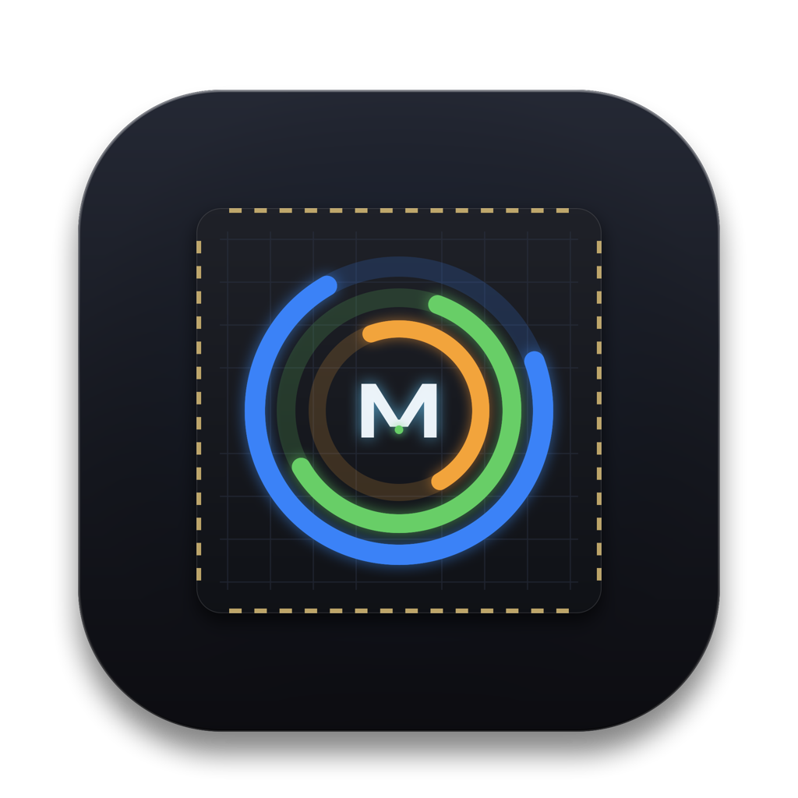

<p align="center">
  
</p>

<h1 align="center">MacStatus</h1>

<p align="center">
  <em>เครื่องมือตรวจสอบสถานะฮาร์ดแวร์แบบ Native น้ำหนักเบาพิเศษ ไม่เกะกะสายตา บน Menu Bar ของ macOS — ออกแบบและปรับแต่งมาเพื่อ Apple Silicon (M1/M2/M3/M4) โดยเฉพาะ</em>
</p>

<p align="center">
  <a href="README.md">English</a> | <strong>ภาษาไทย</strong>
</p>

[](https://apple.com)
[-orange?style=flat-square)](https://apple.com)
[](https://swift.org)
[](LICENSE)

---

## 🌟 ภาพรวม (Overview)

**MacStatus** เป็นแอปพลิเคชันยูทิลิตี้แบบ Native บนแถบเมนู (Menu Bar) ของ macOS ที่พัฒนาขึ้นมาเพื่อทดแทนแอปมอนิเตอร์ทั่วไปที่เทอะทะและกินพลังงานสูง สร้างด้วย **Swift 6, SwiftUI และ AppKit** แท้ 100% ช่วยให้คุณดูสถานะการทำงานสำคัญของเครื่องได้ทันทีผ่านแดชบอร์ด 2 แถวขนาดกะทัดรัด (หรือเลือกใช้วงแหวนกิจกรรม Circular Rings) โดยไม่เกะกะสายตาและใช้ทรัพยากรเครื่องน้อยมาก

```text
┌───────────────────────────────────────┐
│ CPU 10% │ SSD 77% │ ▲ 1.2M            │  <- Menu Bar (Two-Row Dashboard)
│ RAM 70% │ TMP 52° │ ▼ 4.5M            │
└───────────────────────────────────────┘
```

เมื่อคลิกที่แถบสถานะ จะขยายเป็นหน้าต่างป๊อปอัปดีไซน์โมเดิร์นสไตล์ Apple แสดงข้อมูลระบบเชิงลึกแบบเรียลไทม์ การกระจายงานระหว่างแกนประมวลผล โปรเซสที่กินทรัพยากรสูงสุด และสถานะความร้อน

---

## ✨ ความสามารถเด่น (Features)

### 1. แดชบอร์ดมินิมอล 2 แถวบนแถบเมนู (Menu Bar)
* **การจัดวางแบบ Pro Layout:** โครงสร้าง 3 คอลัมน์ 2 แถว ออกแบบมาให้พอดีกับ Menu Bar ขนาดมาตรฐาน 22pt ของ macOS
  * **คอลัมน์ 1:** **CPU** % (สี Fresh Mint `#63E6E2`) และ **RAM** % (สีเขียว `#30D158`)
  * **คอลัมน์ 2:** **SSD** % (สีส้ม `#FF9F0A`) และ **TMP** อุณหภูมิชิป SoC (สีเปลี่ยนตามระดับความร้อน)
  * **คอลัมน์ 3:** อัตราความเร็วเครือข่ายเรียลไทม์ อัปโหลด (▲) และดาวน์โหลด (▼)
* **ฟอนต์และการเว้นวรรคประณีต:** ตัวเลขแบบ Monospaced พร้อมเส้นแบ่งคอลัมน์แบบโปร่งแสง รองรับตัวเลขหลายหลัก (สูงสุด 100% และความเร็วระดับหลาย MB/s) โดยไม่เบียดหรือตกขอบ
* **ตัวเลือกวงแหวนกิจกรรม (Circular Rings):** มีคอมโพเนนต์ `CircularRingsView` สำหรับผู้ที่ชอบเกจวัดทรงกลมสไตล์ Apple Watch
* **ไม่ขยับสั่นไหว (Zero Jitter):** กำหนดขนาดคงที่ (190pt) ป้องกันแถบเมนูเด้งยืดหด และไม่ชนขอบรอยบากหน้าจอ (Notch) บน MacBook รุ่นใหม่

### 2. หน้าต่างป๊อปอัปรายละเอียดเชิงลึก (Deep Telemetry Popover)
* **⚡ หน่วยประมวลผล CPU:**
  * อัตราการใช้งานรวมแบบเรียลไทม์
  * การกระจายภาระงานระหว่าง Efficiency Cores (E-Cores) และ Performance Cores (P-Cores)
  * แสดง 3 อันดับโปรเซสที่ใช้ CPU สูงสุดในขณะนั้น
* **🧠 หน่วยความจำ Unified Memory (RAM):**
  * สัดส่วนการใช้งานจริงเทียบกับความจุทั้งหมด (เช่น `18.6 GB / 32.0 GB`)
  * แยกประเภท App Memory, Wired Memory และ Compressed Memory
  * แสดงระดับแรงดันหน่วยความจำ (Memory Pressure: `Normal`, `Warning`, `Critical`)
  * แสดง 3 อันดับโปรเซสที่ใช้แรมสูงสุด
* **💾 พื้นที่จัดเก็บข้อมูล (Macintosh HD):**
  * พื้นที่ว่างที่เหลือและเปอร์เซ็นต์ที่ใช้ไป
  * ความเร็ว Read & Write I/O แบบเรียลไทม์ (ผ่าน IOKit `IOBlockStorageDriver`)
* **🌐 การเชื่อมต่อเครือข่าย (Network):**
  * ความเร็วรับส่งข้อมูล ดาวน์โหลด (▼) และอัปโหลด (▲) แบบเรียลไทม์
  * แสดงอินเทอร์เฟซที่ใช้งานอยู่ (เช่น `en0`) และหมายเลข IP ภายในเครื่อง
* **🌡 เซนเซอร์ความร้อน Apple Silicon SoC:**
  * อ่านค่าอุณหภูมิเซนเซอร์ฮาร์ดแวร์จริงในหน่วยองศาเซลเซียสผ่าน `IOHIDEventSystem`
  * แสดงสถานะแรงดันความร้อน (`Nominal`, `Fair`, `Serious`, `Critical`)
  * แสดงสถานะความเร็วรอบพัดลม (`RPM` หรือ `Fanless` สำหรับเครื่องไร้พัดลมอย่าง MacBook Air)
* **⚡ คำสั่งด่วน (Quick Actions):**
  * ปุ่มคลิกเดียวเพื่อเปิด **Activity Monitor** ของ macOS ทันที
  * ปุ่มออกจากโปรแกรม (Quit)

### 3. ประหยัดพลังงานและใช้ทรัพยากรต่ำมาก
* **Adaptive Polling:** ปรับความถี่การดึงข้อมูลอัตโนมัติเป็น `2.0s` เมื่อแสดงผลบน Menu Bar และเร่งเป็น `1.0s` เฉพาะเวลาที่เปิดหน้าต่างป๊อปอัปดูรายละเอียด
* **หยุดทำงานเมื่อหน้าจอดับ (Display Sleep Aware):** พักการดึงข้อมูลทั้งหมดเมื่อหน้าจอเข้าสู่โหมด Sleep เพื่อประหยัดพลังงานแบตเตอรี่
* **อัตราการกินทรัพยากร:** ตอนเปิดทำงานทั่วไปกิน CPU `< 0.5%` และใช้แรม `< 30 MB`
* **100% Native:** ไม่ใช้ Electron หรือ Webview เชื่อมต่อตรงกับ Darwin/Mach kernel APIs (`mach_host`, `vm_statistics64`), `libproc` และ IOKit

---

## 📋 ความต้องการของระบบ (Requirements)

* **ระบบปฏิบัติการ:** macOS 13.0 (Ventura), macOS 14.0 (Sonoma), macOS 15.0 (Sequoia) หรือใหม่กว่า
* **ฮาร์ดแวร์:** Mac ชิป Apple Silicon (M1, M2, M3, M4 — รุ่น Base, Pro, Max, Ultra)
* **สำหรับการพัฒนา:** Xcode 16+ / Swift 6.0+

---

## 🚀 การคอมไพล์และการรันโปรแกรม (Building & Running)

### ใช้งานผ่าน Make (แนะนำ)

```bash
make help        # ดูคำสั่ง build ทั้งหมดที่มี
make build       # บิลด์ไฟล์ executable สำหรับ debug
make release     # บิลด์เวอร์ชัน release พร้อมออปติไมซ์
make test        # รันชุดทดสอบทั้งหมด
make run         # คอมไพล์และเปิดรันโปรแกรมทันที
make app         # แพ็กเกจเป็น build/MacStatus.app พร้อมไอคอนและ Info.plist
make install     # แพ็กเกจและติดตั้งลงในโฟลเดอร์ /Applications
make clean       # ล้างไฟล์บิลด์ชั่วคราว
```

### การบิลด์ด้วย Swift Package Manager ด้วยตนเอง

```bash
# Clone โค้ดจาก repository
git clone https://github.com/chanchai9666/macStatus.git
cd macStatus

# คอมไพล์ในโหมด release
swift build -c release

# สั่งรันโปรแกรม
.build/release/MacStatusApp
```

### 2. แพ็กเกจเป็นแอปพลิเคชัน macOS (`.app`)

มีสคริปต์สำหรับการคอมไพล์ จัดชุดบันเดิล และทำ ad-hoc code sign ให้พร้อมใช้งาน:

```bash
./scripts/build-app.sh
```

แอปที่ได้จะอยู่ในโฟลเดอร์ `build/MacStatus.app` สามารถลากหรือคัดลอกไปยังโฟลเดอร์ `/Applications`:

```bash
cp -r build/MacStatus.app /Applications/
```

### 3. การรันชุดทดสอบ (Unit Tests)

```bash
swift test
```

---

## 📁 โครงสร้างโปรเจกต์ (Project Structure)

```text
macStatus/
├── Package.swift                    # กำหนดค่า SwiftPM package
├── Makefile                         # ศูนย์รวมคำสั่งสำหรับนักพัฒนา (build, test, app, install)
├── Resources/
│   ├── AppIcon.icns                 # ชุดไอคอน macOS หลากความละเอียด (16x16 ถึง 1024x1024)
│   ├── AppIcon.png                  # รูปภาพพรีวิวไอคอนความละเอียดสูง
│   └── Info.plist                   # ค่า Metadata ของแอปบันเดิล (LSUIElement = true ไม่โชว์บน Dock)
├── scripts/
│   ├── build-app.sh                 # สคริปต์แพ็กเกจเป็น .app พร้อม codesign
│   └── generate-icon.swift          # สคริปต์เจนไอคอนเวกเตอร์ผ่านโค้ด (AppKit/CoreGraphics)
├── Sources/
│   └── MacStatusApp/
│       ├── App/
│       │   └── StatusBarController.swift  # ตัวจัดการแถบสถานะ ป๊อปอัป และการเข้า Sleep
│       ├── Telemetry/
│       │   ├── Models.swift               # โครงสร้างข้อมูล CPU, RAM, Disk, Net, Thermal
│       │   ├── Formatters.swift           # ตัวแปลงหน่วยข้อมูล ความเร็ว และตรรกะสี
│       │   ├── CPUMonitor.swift           # อ่านโหลด CPU และการแยก Core จาก Mach host
│       │   ├── MemoryMonitor.swift        # อ่านหน่วยความจำ Unified Memory ผ่าน vm_statistics64
│       │   ├── DiskMonitor.swift          # อ่านข้อมูลพื้นที่ว่าง statfs และ I/O ผ่าน IOKit
│       │   ├── NetworkMonitor.swift       # อ่านทราฟฟิกเน็ตเวิร์กผ่าน getifaddrs
│       │   ├── ThermalMonitor.swift       # อ่านอุณหภูมิเซนเซอร์ชิปผ่าน IOHIDEventSystem
│       │   ├── ProcessMonitor.swift       # ดึงรายการโปรเซสและทรัพยากรผ่าน libproc
│       │   └── SystemTelemetryService.swift # ตัวประสานงานหลักของระบบ Telemetry ทั้งหมด
│       ├── UI/
│       │   ├── TwoRowStackedView.swift    # แดชบอร์ดเมนูบาร์ 2 แถว (ค่าเริ่มต้น)
│       │   ├── CircularRingsView.swift    # เกจวัดแบบวงแหวนกิจกรรมสำหรับแถบเมนู
│       │   ├── RingGauge.swift            # คอมโพเนนต์ SwiftUI สำหรับวาดเกจวงแหวน
│       │   ├── PopoverDetailView.swift    # หน้าต่างแดชบอร์ดแสดงผลข้อมูลเชิงลึกเมื่อคลิก
│       │   └── Components/
│       │       ├── MetricCard.swift       # การ์ดแสดงผลสไตล์กระจกโปร่งแสง (Glassmorphic)
│       │       └── ProcessListView.swift  # คอมโพเนนต์แสดงรายการโปรเซสที่ใช้ทรัพยากรสูงสุด
│       └── main.swift                     # จุดเริ่มต้นของแอปพลิเคชัน NSApplication
└── Tests/
    └── MacStatusAppTests/                 # ชุดทดสอบ Unit Tests (Telemetry, UI geometry, Edge cases)
```

---

## 🔒 ความเป็นส่วนตัวและความปลอดภัย (Permissions & Security)

* **ไม่ใช้ App Sandbox:** MacStatus ได้รับการออกแบบให้ทำงานนอก Sandbox เพื่อให้สามารถอ่านค่าเคอร์เนล Darwin/Mach, เซนเซอร์อุณหภูมิ IOHID และรายการโปรเซสของระบบได้โดยตรง **โดยไม่ต้องขอสิทธิ์ Root หรือรหัสผ่าน `sudo`**
* **ความเป็นส่วนตัว 100%:** ข้อมูลสถานะฮาร์ดแวร์ทั้งหมดจะถูกประมวลผลอยู่เฉพาะในแรมของเครื่องเท่านั้น ไม่มีการส่งคำขอเครือข่าย หรือส่งข้อมูลวิเคราะห์ใดๆ ออกนอกเครื่องโดยเด็ดขาด

---

## 📄 สัญญาอนุญาต (License)

โปรเจกต์นี้เปิดเผยซอร์สโค้ดแบบโอเพนซอร์สภายใต้ [MIT License](LICENSE)

